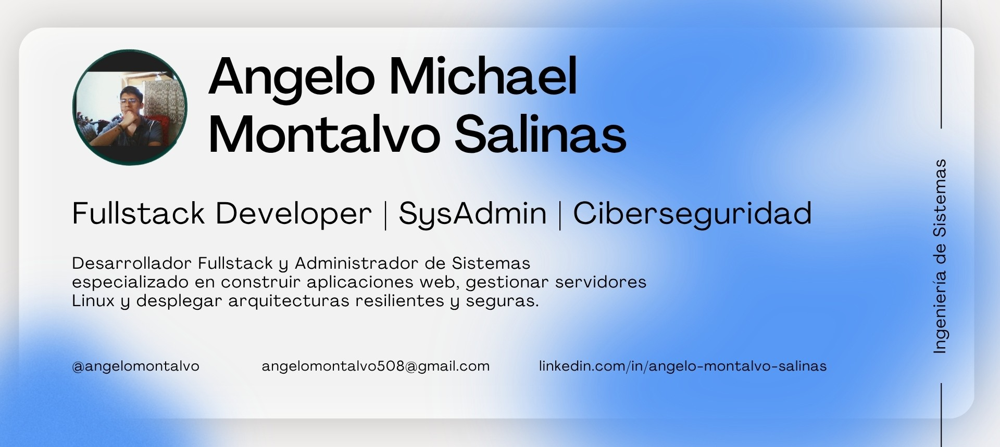

<h1 align="center">Hola, soy Angelo Montalvo 👋</h1>

  

## Sobre mí :)
Estudiante de 8.º ciclo de Ingeniería de Sistemas (décimo superior) enfocado en Desarrollo Web, DevOps y Administración de Sistemas. Cuento con experiencia integral en la construcción de soluciones Fullstack, desarrollo de API REST y gestión de infraestructuras Cloud en entornos VPS (AWS, Hetzner, OVHcloud, Contabo). Mi objetivo es diseñar y desplegar arquitecturas tecnológicas escalables utilizando Linux, Docker y servidores web (Nginx, Apache, Traefik), priorizando siempre la disponibilidad, la resiliencia y la ciberseguridad de los ecosistemas.

## Tecnologías y Herramientas 💻

## Contáctame 📫
- 📧 Correo: angelomontalvo508@gmail.com
- 💼 LinkedIn: [linkedin.com/in/angelo-montalvo-salinas](https://linkedin.com/in/angelo-montalvo-salinas)
- 📍 Ubicación: Ventanilla, Callao, Perú